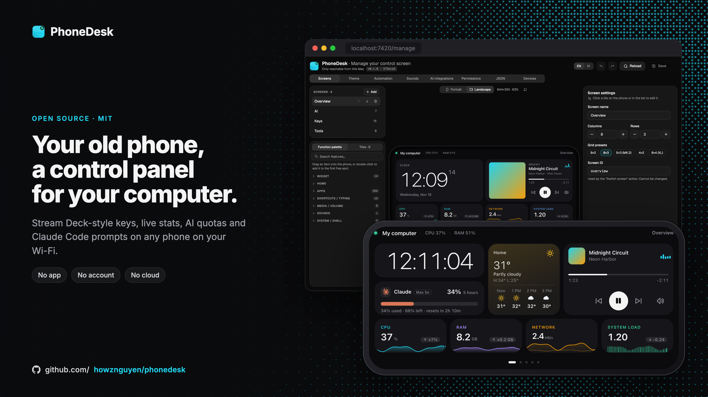
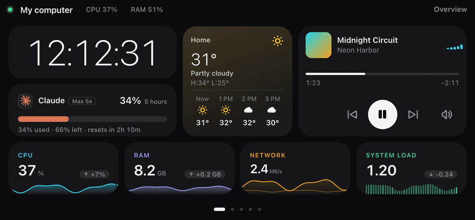
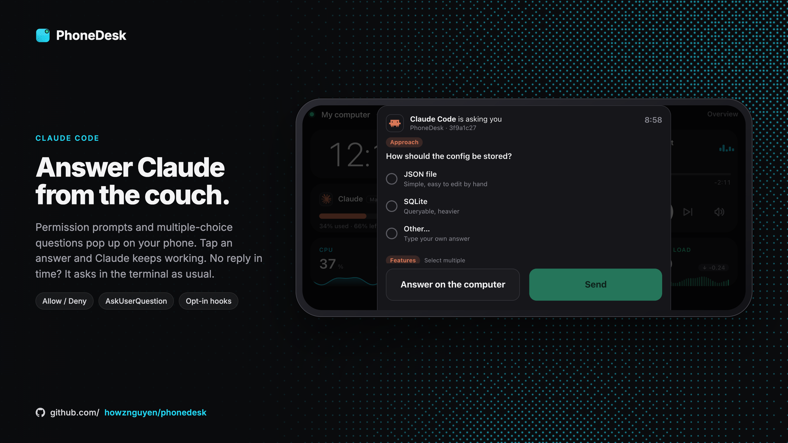
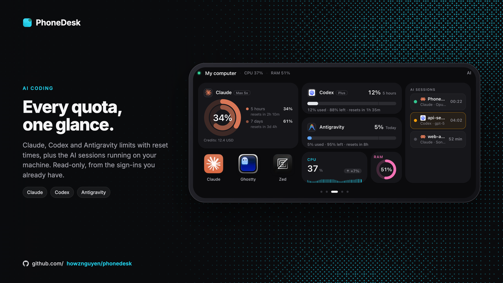
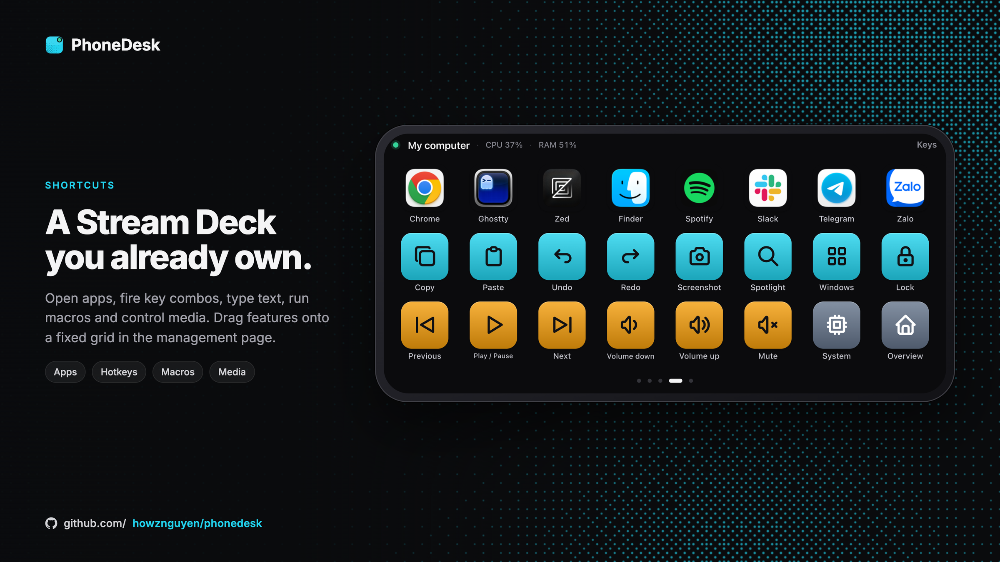
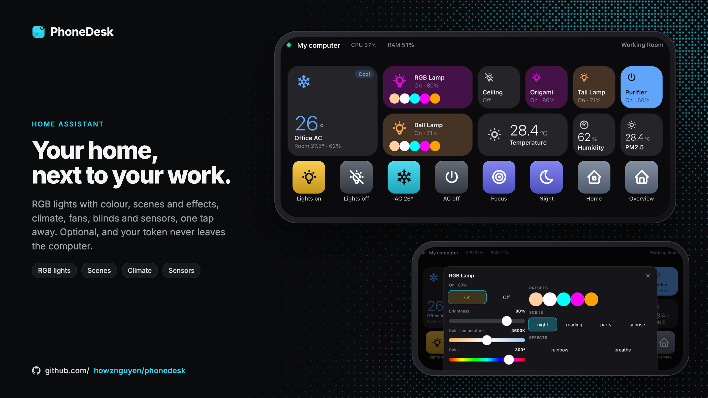

<p align="center">
  
</p>

<h1 align="center">PhoneDesk</h1>

<p align="center"><b>Your old phone, a control panel for your computer.</b></p>

<p align="center">
  <a href="https://github.com/howznguyen/phonedesk/releases"></a>
  <a href="LICENSE"></a>
  
</p>

<p align="center"><b>English</b> · <a href="README.vi.md">Tiếng Việt</a></p>

Turn an old phone or tablet into a Stream Deck-style control panel and dashboard for your Mac or Windows PC. PhoneDesk is a small
agent that runs on your computer and serves a touch overlay to any browser on the same Wi-Fi. There is no app to
install on the phone and no account or cloud service.

> **Status:** early (0.x). macOS is the main target, Windows is experimental. Builds are not signed with a Developer ID or notarized: see [Quick start](#quick-start).

<p align="center"></p>

## What you can do

| Use it for | On the phone |
|---|---|
| **Shortcuts** | Open apps (with their real icons) and URLs, key combinations, type text, shell commands, macros, media and volume keys |
| **Monitoring** | CPU, memory, network, load and uptime with selectable chart styles; tap CPU for the process list |
| **AI coding** | Claude, Codex and Antigravity quotas with reset times; pick which windows to show (5 hours, 7 days, per model); local Claude Code / Codex sessions |
| **Claude Code from the couch** | Answer **Allow / Deny** permission prompts and Claude's multiple-choice questions on the phone (opt-in hooks) |
| **Everyday** | Now Playing with artwork and Resume, 6 clock styles and world clocks, weather (hourly and daily, °C or °F), a soundboard, notifications |
| **Home Assistant** | Lights with colour, colour temperature, scenes and effects; climate (mode, fan, swing), fans, covers, vacuums, locks and sensors (optional) |
| **Automation** | Webhooks that push values and notifications, rules that react to activity on the computer |
| **Make it yours** | Drag-and-drop grid (8×3, 8×2, 5×3…), 4 tile styles (Soft, Solid, Outline, iOS), any colour per tile, 5,000+ icons, English or Vietnamese |

The layout is a fixed grid of square tiles built in a drag-and-drop management page at `http://localhost:7420/manage/`.
An MCP server lets an AI assistant arrange the layout for you. Runs on macOS, and on Windows 10/11 (experimental).

## Screenshots

<p align="center"><br><sub>A 16-second tour with demo data: pages, AI quotas, keys, Home Assistant and a Claude Code question.</sub></p>

<table>
<tr>
<td width="50%"></td>
<td width="50%"></td>
</tr>
<tr>
<td align="center"><b>Answer Claude Code from your phone</b></td>
<td align="center"><b>AI quotas and sessions</b></td>
</tr>
<tr>
<td width="50%"></td>
<td width="50%"></td>
</tr>
<tr>
<td align="center"><b>Stream Deck-style keys</b></td>
<td align="center"><b>Home Assistant</b></td>
</tr>
</table>

## Quick start

On a Mac (Apple silicon or Intel), run this in Terminal. It needs no `sudo`:

```sh
curl -fsSL https://raw.githubusercontent.com/howznguyen/phonedesk/main/setup.sh | bash
```

It downloads the latest release, checks its SHA-256 against the release's `SHA256SUMS` (and refuses on a mismatch),
installs the program to `~/.phonedesk/bin/phonedesk`, offers to start PhoneDesk at login (a launchd service), starts it,
and prints the phone URL and pairing PIN. Options go after `bash -s --`, for example `--yes` (no questions),
`--no-autostart`, `--no-open`, `--port 7421`, `--version 0.2.0`, `--dry-run`.

- **Update:** run the same command again. Your layout, paired phones and settings in `~/.phonedesk` are kept.
- **Uninstall:**
  ```sh
  curl -fsSL https://raw.githubusercontent.com/howznguyen/phonedesk/main/uninstall.sh | bash
  ```
  This removes the service, PhoneDesk's Claude Code / Codex hooks (with a backup) and the program, and keeps your data.
  Add `-s -- --purge` after `bash` to delete `~/.phonedesk` as well.
- **Background service:** `phonedesk service install|uninstall|status|restart`; logs are in `~/.phonedesk/logs`.
- **Signing:** the binaries are signed ad hoc, not with an Apple Developer ID, and are not notarized. The installer
  downloads with `curl` (no quarantine flag) and signs the file again on your Mac, so Gatekeeper does not block it. If you
  download a binary in a browser instead, macOS may refuse to open it: run `xattr -d com.apple.quarantine <file>`.
  Check what you are running with `phonedesk --version`.

## Pair your phone

PhoneDesk prints a phone URL and a 6-digit PIN when it starts. Use whichever is easiest:

| Way | How |
|---|---|
| **Scan with the Camera app** | Point the phone's Camera at the QR code in the terminal (shown at start and at the end of the installer) or in **Manage › Devices**. The link carries the PIN, so the phone pairs right away. |
| **Scan QR on the pairing page** | Open the phone URL and tap **Scan QR**. The phone takes a photo of the QR on your computer and pairs. Live camera scanning needs HTTPS, so this uses a photo instead. |
| **Type the PIN** | Open the phone URL (for example `http://your-mac.local:7420`) and enter the 6 digits. |

The phone stays paired across restarts (the token is kept in a cookie). Add the page to the home screen for a full-screen
panel. Remove a phone in **Manage › Devices**.

## Windows quick start (experimental)

Windows 10/11 (x64) support is **experimental**: it has not been verified on every setup yet, so expect rough edges and
please report them. In PowerShell (no administrator needed):

```powershell
irm https://raw.githubusercontent.com/howznguyen/phonedesk/main/setup.ps1 | iex
```

It downloads `phonedesk-windows-x64.exe`, checks its SHA-256 against the release's `SHA256SUMS`, installs it for your
user, offers to start PhoneDesk at sign-in (a per-user Task Scheduler task, no admin), starts it, and prints the phone URL
and pairing PIN.

- **Uninstall:** `irm https://raw.githubusercontent.com/howznguyen/phonedesk/main/uninstall.ps1 | iex` (keeps your data).
- **Firewall:** the installer adds one inbound rule for `phonedesk.exe`, limited to your local subnet (one UAC prompt), before the first start, so Windows does not block phones.
- **Known issue:** typing text from a tile (and macros that type) can produce wrong characters on Windows; opening apps, shortcuts, media and volume work. A fix is in progress.
- **SmartScreen:** an unsigned download may show "Windows protected your PC": choose *More info*, then *Run anyway*.
- **Shortcuts:** in a layout, `cmd` means Ctrl on Windows and `option` means Alt. The management page shows Ctrl/Alt/Shift
  there and the Mac symbols on macOS. Shortcuts that need the Windows key cannot be pressed.
- Open the management page's **Permissions** tab to check the firewall and the helper.

## Install from source

Requirements: macOS 13+ (Apple silicon or Intel), or Windows 10/11 x64 (experimental). Linux is not tested yet.

From source (needs [Bun](https://bun.sh) 1.3+):

```sh
git clone https://github.com/howznguyen/phonedesk && cd phonedesk
bun install
bun run build          # builds the web apps and dist/phonedesk
./dist/phonedesk       # prints the phone URL and a pairing PIN
```

On Windows, `bun run build:win` produces `dist/phonedesk-windows-x64.exe`.

Open the printed URL on your phone (same Wi-Fi), enter the PIN, and add the page to the home screen for a
full-screen panel. The management page is at `http://localhost:7420/manage/` on the Mac.

macOS asks for **Accessibility** permission the first time a tile sends key presses.

## Claude Code integration (optional)

In **Manage › AI**, two separate switches install hooks into `~/.claude/settings.json` (a backup is written first):

- **Permission prompts**: a `PermissionRequest` hook shows Allow / Deny on the phone.
- **Questions**: a `PreToolUse` hook for `AskUserQuestion` shows Claude's options on the phone and returns your
  choice. Optionally only while you are away from the keyboard.

If no phone answers in time, Claude Code asks in the terminal as usual. For Codex, the permission hook goes into
`~/.codex/hooks.json`.

Quotas are read-only: PhoneDesk reads the sign-in Claude Code already stored (never refreshes it), Codex's local
session files and Antigravity's local server. See [PRIVACY.md](PRIVACY.md) for every outbound connection.

## Permissions

macOS ties each permission to the program that asks. Under the background service that is the `phonedesk` binary; started from a terminal it is the terminal app. Run `phonedesk doctor` to see what is granted (it asks the running agent, never shows a prompt by itself):

| Permission | Needed for | Where |
|---|---|---|
| Accessibility | key press, typing and volume tiles | Privacy & Security > Accessibility |
| Automation: System Events, Music, Spotify | key tiles, Now Playing and media keys | Privacy & Security > Automation |
| Keychain: Claude Code | Claude usage quota (read-only) | macOS asks once: choose Always Allow |
| Local Network | Home Assistant on your LAN | Privacy & Security > Local Network |
| Firewall | phones connecting to the agent | Network > Firewall > Options |

```bash
phonedesk doctor                          # ✓ / ✗ for each item, with the fix
phonedesk doctor --open accessibility     # open the right Settings pane
phonedesk doctor --request accessibility  # make macOS list phonedesk (shows its prompt)
```

Updates are ad-hoc signed, so macOS may ask again after an update: remove the old `phonedesk` entry from the Privacy list and add it again. This goes away once releases are signed with a Developer ID.

**On Windows** `phonedesk doctor` checks different things (same commands, `phonedesk doctor --open firewall` opens Windows Security):

| Check | Why it matters |
|---|---|
| Firewall | Windows blocks incoming connections unless a rule allows `phonedesk.exe`; the installer offers one rule, for your local subnet only (one UAC prompt, removed by `uninstall.ps1`). Manually, as administrator: `netsh advfirewall firewall add rule name="PhoneDesk" dir=in action=allow program="<path>\phonedesk.exe" profile=any remoteip=localsubnet` |
| Network profile | Your Wi-Fi or Ethernet should be a Private network (Settings > Network & internet) |
| Desktop session | Key presses, typing, Now Playing and volume only work when PhoneDesk runs in your signed-in desktop session (the scheduled task does; an SSH session or a Windows service does not) |
| PowerShell helper | Now Playing, volume, app icons and the process list use a small Windows PowerShell 5.1 helper |
| SmartScreen | A downloaded `phonedesk.exe` carrying the internet mark triggers warnings; the installer removes it |

## AI layout assistant (MCP)

PhoneDesk ships an MCP server, so Claude Code (or any MCP client) can arrange your deck in plain language: "add a page with my dev tools", "put Spotify next to the clock". It talks to the running agent, so start PhoneDesk first.

Register it once, with the path the installer used:

| Installed with | Command |
|---|---|
| `setup.sh` (macOS) | `claude mcp add phonedesk -- ~/.phonedesk/bin/phonedesk mcp` |
| `setup.ps1` (Windows) | `claude mcp add phonedesk -- "%LOCALAPPDATA%\PhoneDesk\bin\phonedesk.exe" mcp` |
| Built from source | `claude mcp add phonedesk -- /full/path/to/dist/phonedesk mcp` |

Add `--port N` after `mcp` if the agent does not use port 7420, and `--scope user` before `phonedesk` to make it available in every project. Check it with `claude mcp list`.

Tools: `get_layout`, `add_page`, `add_item`, `update_item`, `move_item`, `resize_item`, `remove_item`, `update_page`, `remove_page`, `set_theme`, `list_apps`, `list_widgets`, `search_icons`, `preview_changes`, `undo`. Every change goes through the same validation as the management page and can be undone. The [layout skill](docs/skills/phonedesk-layout/SKILL.md) describes the schema to the assistant.

## Security

- The agent listens on your LAN. Phones must pair with a 6-digit PIN; the device token is kept in a cookie.
- The management API only answers on `localhost` and rejects cross-site and DNS-rebinding requests.
- Tiles can run shell commands you configure. Only pair devices you trust.

## Development

```sh
bun run dev     # agent with watch mode
bun run test    # unit tests
```

Layout: `src/` agent (Bun + TypeScript), `web/deck` phone overlay (Preact, Safari 12+), `web/manage` management page
(React), `web/shared` code used by both.

## Credits

- Icons: [Tabler Icons](https://tabler.io/icons) (MIT) and [LobeHub Icons](https://github.com/lobehub/lobe-icons) (MIT).
- UI components: [Knowns UI](https://ui.knowns.dev).
- Weather data: [Open-Meteo](https://open-meteo.com) (CC BY 4.0).

## License

[MIT](LICENSE)
