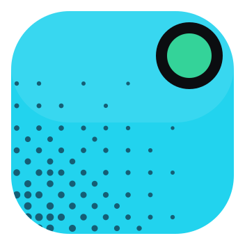
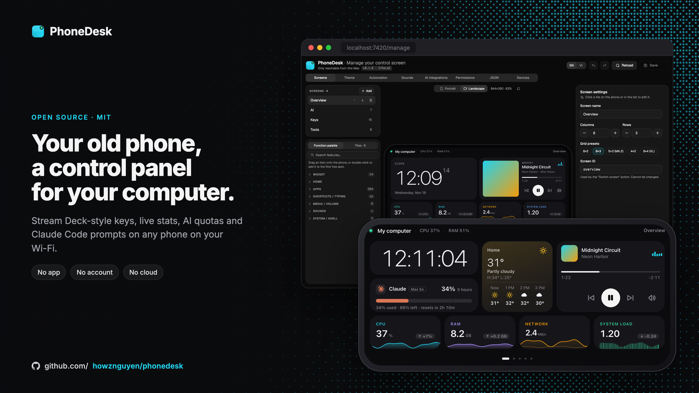
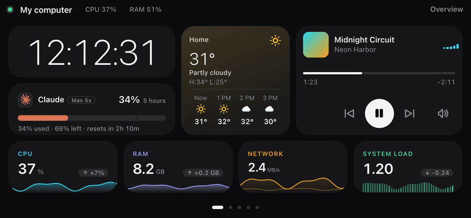
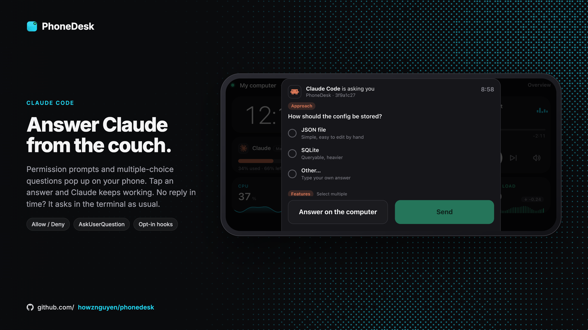
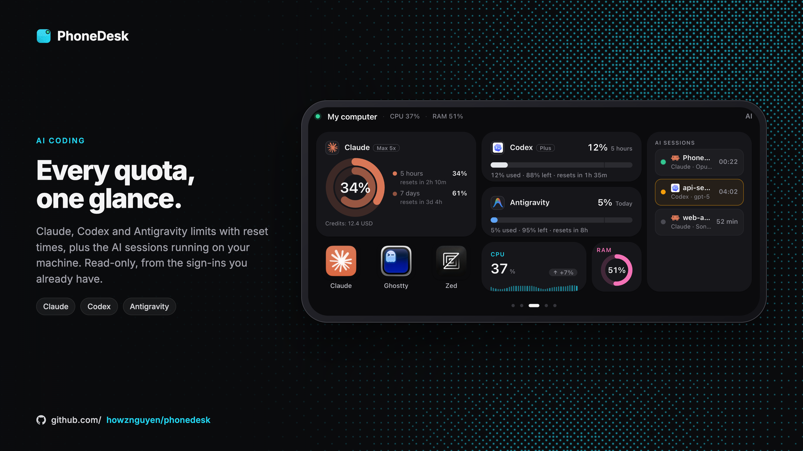
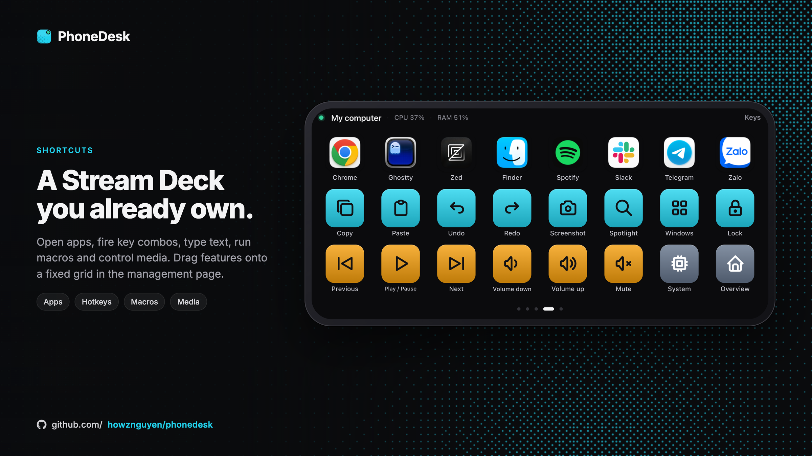
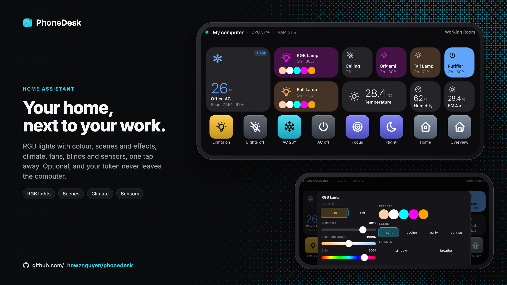

<p align="center">
  
</p>

<h1 align="center">PhoneDesk</h1>

<p align="center"><b>Điện thoại cũ thành bảng điều khiển cho máy tính.</b></p>

<p align="center">
  <a href="https://github.com/howznguyen/phonedesk/releases"></a>
  <a href="LICENSE"></a>
  
</p>

<p align="center"><a href="README.md">English</a> · <b>Tiếng Việt</b></p>

Biến điện thoại hoặc máy tính bảng cũ thành bảng điều khiển kiểu Stream Deck và màn hình theo dõi cho Mac hoặc PC Windows. PhoneDesk
là một agent nhỏ chạy trên máy tính, phục vụ giao diện cảm ứng cho trình duyệt bất kỳ trong cùng mạng Wi-Fi. Không cần
cài app trên điện thoại, không cần tài khoản hay dịch vụ đám mây.

> **Trạng thái:** bản đầu (0.x). Hỗ trợ chính là macOS, Windows đang thử nghiệm. Binary chưa ký bằng Developer ID và chưa notarize: xem [Bắt đầu nhanh](#bắt-đầu-nhanh).

<p align="center"></p>

## Làm được gì

| Dùng cho | Trên điện thoại |
|---|---|
| **Phím tắt** | Mở app (kèm icon thật) và URL, tổ hợp phím, gõ chữ, lệnh shell, macro, phím media và âm lượng |
| **Theo dõi máy** | CPU, RAM, mạng, tải và thời gian chạy, chọn được kiểu biểu đồ; chạm CPU để xem danh sách tiến trình |
| **Lập trình với AI** | Quota và thời điểm reset của Claude, Codex, Antigravity; chọn được mốc muốn xem (5 giờ, 7 ngày, theo model); các phiên Claude Code / Codex trên máy |
| **Điều khiển Claude Code từ xa** | Trả lời **Cho phép / Từ chối** và các câu hỏi nhiều lựa chọn của Claude ngay trên điện thoại (bật khi cần) |
| **Hằng ngày** | Đang phát kèm ảnh bìa và nút phát tiếp, 6 kiểu đồng hồ và giờ thế giới, thời tiết (theo giờ, theo ngày, °C hoặc °F), soundboard, thông báo |
| **Home Assistant** | Đèn có màu, nhiệt độ màu, cảnh và hiệu ứng; điều hòa (chế độ, quạt, đảo gió), quạt, rèm, robot hút bụi, khóa và cảm biến (tùy chọn) |
| **Tự động hóa** | Webhook đẩy giá trị và thông báo, rule phản ứng theo hoạt động trên máy |
| **Tùy biến** | Lưới kéo thả (8×3, 8×2, 5×3…), 4 kiểu ô (Soft, Solid, Outline, iOS), màu riêng cho từng ô, hơn 5.000 icon, tiếng Anh hoặc tiếng Việt |

Layout là lưới ô vuông cố định, sắp xếp bằng kéo thả ở trang quản lý `http://localhost:7420/manage/`. Có MCP server để
trợ lý AI sắp xếp layout giúp bạn. Chạy trên macOS, và Windows 10/11 (thử nghiệm).

## Ảnh chụp

<p align="center"><br><sub>Một vòng 16 giây với dữ liệu mẫu: các trang, quota AI, phím, Home Assistant và câu hỏi của Claude Code.</sub></p>

<table>
<tr>
<td width="50%"></td>
<td width="50%"></td>
</tr>
<tr>
<td align="center"><b>Trả lời Claude Code trên điện thoại</b></td>
<td align="center"><b>Quota và phiên AI</b></td>
</tr>
<tr>
<td width="50%"></td>
<td width="50%"></td>
</tr>
<tr>
<td align="center"><b>Lưới phím kiểu Stream Deck</b></td>
<td align="center"><b>Home Assistant</b></td>
</tr>
</table>

## Bắt đầu nhanh

Trên Mac (Apple silicon hoặc Intel), chạy lệnh này trong Terminal, không cần `sudo`:

```sh
curl -fsSL https://raw.githubusercontent.com/howznguyen/phonedesk/main/setup.sh | bash
```

Script tải bản phát hành mới nhất, kiểm tra SHA-256 theo `SHA256SUMS` của bản đó (không khớp thì dừng), cài chương trình vào
`~/.phonedesk/bin/phonedesk`, hỏi có chạy PhoneDesk khi đăng nhập không (dịch vụ launchd), khởi động và in địa chỉ cho
điện thoại cùng mã PIN. Tùy chọn viết sau `bash -s --`, ví dụ `--yes` (không hỏi), `--no-autostart`, `--no-open`,
`--port 7421`, `--version 0.2.0`, `--dry-run`.

- **Cập nhật:** chạy lại đúng lệnh trên. Layout, điện thoại đã ghép đôi và cài đặt trong `~/.phonedesk` được giữ nguyên.
- **Gỡ cài đặt:**
  ```sh
  curl -fsSL https://raw.githubusercontent.com/howznguyen/phonedesk/main/uninstall.sh | bash
  ```
  Lệnh này gỡ dịch vụ, các hook Claude Code / Codex của PhoneDesk (có sao lưu) và chương trình, nhưng giữ dữ liệu của bạn.
  Thêm `-s -- --purge` sau `bash` để xóa luôn `~/.phonedesk`.
- **Dịch vụ nền:** `phonedesk service install|uninstall|status|restart`; log ở `~/.phonedesk/logs`.
- **Chữ ký:** file thực thi được ký ad-hoc, không có Apple Developer ID và chưa được notarize. Script tải bằng `curl` (không có
  cờ quarantine) và ký lại trên máy bạn nên Gatekeeper không chặn. Nếu tự tải file bằng trình duyệt, macOS có thể từ chối
  mở: chạy `xattr -d com.apple.quarantine <file>`. Kiểm tra bản đang chạy bằng `phonedesk --version`.

## Ghép đôi điện thoại

Khi khởi động, PhoneDesk in ra địa chỉ cho điện thoại và một mã PIN 6 số. Chọn cách nào tiện nhất:

| Cách | Làm thế nào |
|---|---|
| **Quét bằng app Camera** | Đưa camera điện thoại vào mã QR trong terminal (hiện lúc khởi động và ở cuối bộ cài) hoặc trong **Quản lý › Thiết bị**. Link đã kèm PIN nên điện thoại ghép đôi ngay. |
| **Nút Scan QR trên trang ghép đôi** | Mở địa chỉ cho điện thoại, bấm **Scan QR**. Điện thoại chụp ảnh mã QR trên máy tính rồi tự ghép đôi. Quét camera trực tiếp cần HTTPS nên ở đây dùng ảnh chụp. |
| **Nhập PIN** | Mở địa chỉ cho điện thoại (ví dụ `http://may-cua-ban.local:7420`) và nhập 6 số. |

Điện thoại được nhớ kể cả khi agent khởi động lại (token lưu trong cookie). Thêm trang vào màn hình chính để chạy toàn
màn hình. Gỡ điện thoại trong **Quản lý › Thiết bị**.

## Bắt đầu nhanh trên Windows (thử nghiệm)

Hỗ trợ Windows 10/11 (x64) đang ở mức **thử nghiệm**: chưa được kiểm chứng trên mọi cấu hình, nên có thể còn lỗi vặt,
mong bạn báo lại. Trong PowerShell (không cần quyền quản trị):

```powershell
irm https://raw.githubusercontent.com/howznguyen/phonedesk/main/setup.ps1 | iex
```

Lệnh này tải `phonedesk-windows-x64.exe`, kiểm tra SHA-256 với `SHA256SUMS` của bản phát hành, cài cho riêng tài khoản của
bạn, hỏi có chạy PhoneDesk khi đăng nhập không (một tác vụ Task Scheduler theo người dùng, không cần quyền quản trị), khởi
động và in địa chỉ cho điện thoại cùng mã PIN ghép đôi.

- **Gỡ cài đặt:** `irm https://raw.githubusercontent.com/howznguyen/phonedesk/main/uninstall.ps1 | iex` (giữ lại dữ liệu).
- **Tường lửa:** bộ cài thêm một quy tắc cho `phonedesk.exe`, chỉ trong mạng nội bộ (một lần hỏi UAC), trước lần chạy đầu, nên Windows không chặn điện thoại.
- **Lỗi đã biết:** gõ chữ từ một ô (và macro có bước gõ chữ) có thể ra sai ký tự trên Windows; mở app, phím tắt, media và âm lượng vẫn chạy. Đang sửa.
- **SmartScreen:** tệp tải về chưa ký có thể hiện "Windows protected your PC": chọn *More info*, rồi *Run anyway*.
- **Phím tắt:** trong layout, `cmd` nghĩa là Ctrl trên Windows và `option` nghĩa là Alt. Trang quản lý hiện Ctrl/Alt/Shift
  trên Windows và ký hiệu Mac trên macOS. Phím tắt cần phím Windows thì không bấm được.
- Mở tab **Quyền truy cập** của trang quản lý để kiểm tra tường lửa và trình hỗ trợ.

## Cài từ mã nguồn

Yêu cầu: macOS 13 trở lên (Apple silicon hoặc Intel), hoặc Windows 10/11 x64 (thử nghiệm). Linux chưa được thử.

Từ mã nguồn (cần [Bun](https://bun.sh) 1.3+):

```sh
git clone https://github.com/howznguyen/phonedesk && cd phonedesk
bun install
bun run build          # build web và dist/phonedesk
./dist/phonedesk       # in ra địa chỉ cho điện thoại và mã PIN ghép đôi
```

Mở địa chỉ đó trên điện thoại (cùng Wi-Fi), nhập PIN, rồi thêm trang vào màn hình chính để chạy toàn màn hình. Trang
quản lý ở `http://localhost:7420/manage/` trên Mac. Ngôn ngữ đổi trong **Quản lý › Giao diện** (mặc định tiếng Anh).

Lần đầu một ô gửi phím tắt, macOS sẽ hỏi quyền **Trợ năng (Accessibility)**.

## Tích hợp Claude Code (tùy chọn)

Trong **Quản lý › AI** có hai công tắc riêng, cài hook vào `~/.claude/settings.json` (có backup trước):

- **Hỏi quyền**: hook `PermissionRequest` hiện Cho phép / Từ chối trên điện thoại.
- **Câu hỏi**: hook `PreToolUse` cho `AskUserQuestion` hiện các lựa chọn của Claude trên điện thoại và gửi lại câu trả
  lời. Có thể chỉ bật khi bạn rời bàn phím.

Nếu điện thoại không trả lời kịp, Claude Code hỏi trong terminal như bình thường. Với Codex, hook hỏi quyền được cài
vào `~/.codex/hooks.json`.

Quota chỉ đọc: PhoneDesk đọc phiên đăng nhập Claude Code đã lưu sẵn (không bao giờ làm mới), file session cục bộ của
Codex và server cục bộ của Antigravity. Mọi kết nối ra ngoài được liệt kê trong [PRIVACY.md](PRIVACY.md).

## Quyền macOS

macOS gắn mỗi quyền với chương trình đang xin quyền. Khi chạy dịch vụ nền đó là file `phonedesk`; khi chạy từ Terminal đó là ứng dụng Terminal. Chạy `phonedesk doctor` để xem quyền nào đã cấp (lệnh hỏi chính agent đang chạy, tự nó không hiện hộp thoại nào):

| Quyền | Dùng cho | Ở đâu |
|---|---|---|
| Trợ năng (Accessibility) | các ô gửi phím, gõ chữ và âm lượng | Quyền riêng tư & Bảo mật > Trợ năng |
| Tự động hóa: System Events, Music, Spotify | ô phím, Đang phát và phím media | Quyền riêng tư & Bảo mật > Tự động hóa |
| Keychain: Claude Code | hạn mức Claude (chỉ đọc) | macOS hỏi một lần: chọn Luôn cho phép |
| Mạng cục bộ | Home Assistant trong mạng nhà | Quyền riêng tư & Bảo mật > Mạng cục bộ |
| Tường lửa | điện thoại kết nối vào agent | Mạng > Tường lửa > Tùy chọn |

```bash
phonedesk doctor                          # ✓ / ✗ từng mục, kèm cách sửa
phonedesk doctor --open accessibility     # mở đúng mục trong Cài đặt
phonedesk doctor --request accessibility  # để macOS liệt kê phonedesk (hiện hộp thoại)
```

Bản cập nhật được ký ad-hoc nên macOS có thể hỏi lại sau mỗi lần cập nhật: xóa mục `phonedesk` cũ trong danh sách Quyền riêng tư rồi thêm lại. Việc này hết khi bản phát hành được ký bằng Developer ID.

**Trên Windows** `phonedesk doctor` kiểm tra các mục khác (cùng lệnh; `phonedesk doctor --open firewall` mở Windows Security):

| Mục | Vì sao quan trọng |
|---|---|
| Tường lửa | Windows chặn kết nối đến trừ khi có quy tắc cho `phonedesk.exe`; trình cài đặt đề nghị thêm một quy tắc chỉ cho mạng nội bộ (local subnet) (một lần UAC, `uninstall.ps1` sẽ xóa). Thủ công, bằng quyền quản trị: `netsh advfirewall firewall add rule name="PhoneDesk" dir=in action=allow program="<đường dẫn>\phonedesk.exe" profile=any remoteip=localsubnet` |
| Loại mạng | Wi-Fi hoặc Ethernet nên là mạng Private (Settings > Network & internet) |
| Phiên màn hình | Gửi phím, gõ chữ, Đang phát và âm lượng chỉ hoạt động khi PhoneDesk chạy trong phiên đã đăng nhập (tác vụ đã lên lịch làm đúng như vậy; phiên SSH hoặc Windows service thì không) |
| Trình hỗ trợ PowerShell | Đang phát, âm lượng, biểu tượng app và danh sách tiến trình dùng một trình hỗ trợ Windows PowerShell 5.1 nhỏ |
| SmartScreen | `phonedesk.exe` tải về mang dấu internet sẽ bị cảnh báo; trình cài đặt gỡ dấu này |

## Trợ lý AI sắp xếp layout (MCP)

PhoneDesk có sẵn MCP server, nên Claude Code (hoặc client MCP bất kỳ) sắp xếp được layout bằng lời: "thêm một trang công cụ lập trình", "đặt Spotify cạnh đồng hồ". MCP server nói chuyện với agent đang chạy, nên cần bật PhoneDesk trước.

Đăng ký một lần, với đường dẫn mà bộ cài đã dùng:

| Cài bằng | Lệnh |
|---|---|
| `setup.sh` (macOS) | `claude mcp add phonedesk -- ~/.phonedesk/bin/phonedesk mcp` |
| `setup.ps1` (Windows) | `claude mcp add phonedesk -- "%LOCALAPPDATA%\PhoneDesk\bin\phonedesk.exe" mcp` |
| Build từ mã nguồn | `claude mcp add phonedesk -- /đường/dẫn/đầy/đủ/dist/phonedesk mcp` |

Thêm `--port N` sau `mcp` nếu agent không chạy ở cổng 7420, và `--scope user` trước `phonedesk` để dùng được trong mọi project. Kiểm tra bằng `claude mcp list`.

Các tool: `get_layout`, `add_page`, `add_item`, `update_item`, `move_item`, `resize_item`, `remove_item`, `update_page`, `remove_page`, `set_theme`, `list_apps`, `list_widgets`, `search_icons`, `preview_changes`, `undo`. Mọi thay đổi đều qua cùng bước kiểm tra như trang quản lý và hoàn tác được. [Layout skill](docs/skills/phonedesk-layout/SKILL.md) mô tả schema cho trợ lý.

## Bảo mật

- Agent lắng nghe trong mạng LAN. Điện thoại phải ghép đôi bằng PIN 6 số; token thiết bị lưu trong cookie.
- API quản lý chỉ trả lời trên `localhost`, chặn request từ trang khác và DNS rebinding.
- Ô có thể chạy lệnh shell do bạn cấu hình. Chỉ ghép đôi thiết bị bạn tin tưởng.

## Ghi công

- Icon: [Tabler Icons](https://tabler.io/icons) (MIT) và [LobeHub Icons](https://github.com/lobehub/lobe-icons) (MIT).
- Component giao diện: [Knowns UI](https://ui.knowns.dev).
- Dữ liệu thời tiết: [Open-Meteo](https://open-meteo.com) (CC BY 4.0).

## Giấy phép

[MIT](LICENSE)
